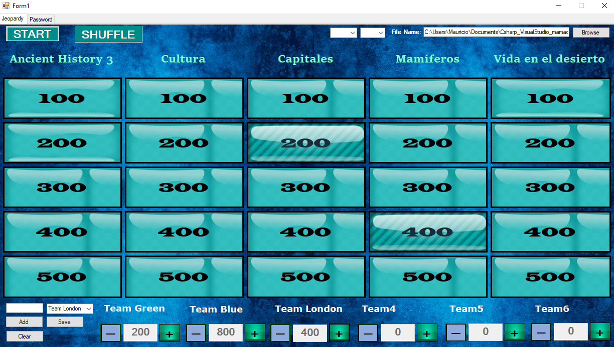
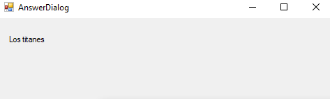
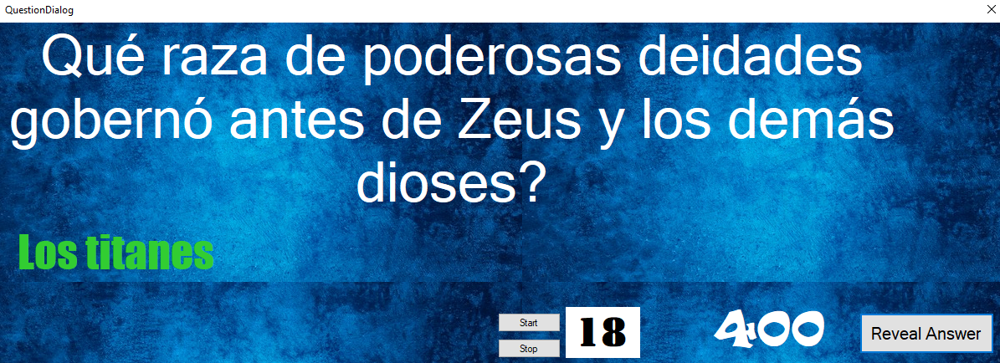

# Jeopardy — Interactive Trivia Game



**A C# Windows Forms application designed to host interactive, team-based Jeopardy-style trivia competitions with dual-screen presentation, customizable questions, and real-time score management.**

## Overview

Jeopardy is an interactive trivia game developed in **C# using Windows Forms**, originally created in November 2021.

The application allows a game coordinator to host and manage Jeopardy-style trivia competitions between multiple teams, providing an interactive game board, customizable categories, timed questions, and a dynamic scoring system.

One of the project's main features is its **dual-screen presentation system**, which separates the coordinator's interface from the audience-facing display. This allows the host to privately view questions and correct answers while participants interact with the game board through a projected screen.

The application is designed for classroom activities, educational competitions, team-building events, and recreational trivia games.

## Key Features

- **Excel-Based Question Database:** Load questions, answers, and categories from an external Excel-format file. A sample database is included in the repository.
- **Customizable Teams:** Register participating teams and display their names on the scoreboard.
- **Interactive Game Board:** Navigate through categories and questions organized by point values.
- **Category Shuffling:** Randomize the order of question categories using the Shuffle button.
- **Dual-Screen Presentation:** Separate the coordinator's private interface from the audience-facing game board.
- **Timed Questions:** Configure an answering timer to manage each question.
- **Controlled Answer Reveal:** Keep correct answers hidden from participants until the coordinator chooses to reveal them.
- **Real-Time Score Management:** Award or deduct points from each team's score using dedicated `+` and `-` controls.

## How to Play

### 1. Load the Question Database

When launching the application, the coordinator must first load the question database.

1. Locate the file selection controls in the **upper-right corner** of the application.
2. Click **Browse** to select the Excel-format database containing the questions and answers.
3. Load the file to prepare the game content.

A sample question database is already included in the repository and can be used to get started.

### 2. Configure the Teams

Before starting the competition, the coordinator must register the participating teams.

1. Locate the team configuration section in the **lower-left corner** of the game interface.
2. Enter the name of each participating team.
3. Click **Add** to include the team in the list.
4. Repeat the process for the remaining teams.
5. Click **Save** to confirm the team configuration.

Once saved, the registered team names appear on the scoreboard, where their scores can be managed throughout the game.

### 3. Set Up the Dual-Screen Presentation

For the intended gameplay experience, **a projector or secondary monitor is strongly recommended**.

The application is designed to provide different information to the game coordinator and the audience.

**Primary Screen — Game Coordinator**

The primary monitor serves as the coordinator's private interface, allowing the host to:

- View the current question and its correct answer.
- Coordinate the answering process.
- Control when the correct answer is revealed.
- Manage the game and team scores.

**Secondary Screen — Participants and Audience**

The secondary monitor or projector displays:

- The interactive Jeopardy game board.
- The available question categories and point values.
- The selected question without initially displaying its answer.
- The answering timer.
- The correct answer once the coordinator reveals it.

**Important:** Configure Windows to use **Extend these displays**, rather than duplicating the same screen. This allows the coordinator to privately access the correct answers while the audience sees only the appropriate game information.

### 4. Shuffle the Question Categories

The game board displays the available question categories at the top of each column.

To randomize their order:

1. Locate the **Shuffle** button at the top of the game board.
2. Click it to rearrange the categories.
3. Review the updated game board before starting the competition.

This feature introduces variety into the game by changing the arrangement of categories.

### 5. Select a Question

Once the teams and categories are configured, the coordinator can begin the competition.

1. Select a question from the game board by clicking its corresponding point value.
2. The selected question is displayed to the participants on the secondary screen.
3. The coordinator can simultaneously view the question and its correct answer on the primary screen.
4. Participants attempt to answer the question within the allowed time.

**Audience View — Question Dialog**

The audience sees the question without the correct answer.


**Coordinator View — Answer Dialog**

The coordinator can privately view both the question and its correct answer while managing the game.



### 6. Manage the Timer and Reveal the Answer

Each question can be managed using an answering timer.

1. Configure the time allowed for participants to respond.
2. Allow the participating team to provide its answer.
3. When appropriate, click **Reveal Answer**.
4. The correct answer becomes visible on the projected screen so everyone can see it.

The answer is initially hidden from participants, even though the coordinator can already see it on the primary monitor.

**Audience View — Revealed Answer**



This functionality allows the coordinator to control the flow of the competition without revealing answers prematurely.

### 7. Update Team Scores

After a team responds, the coordinator determines whether the answer is correct or incorrect.

Each team has a dedicated score display with two controls:

- **`+` Add Points:** Awards the question's point value to the team when it answers correctly.
- **`-` Subtract Points:** Deducts the question's point value when the team answers incorrectly.

The scoreboard is updated as points are awarded or deducted.

This allows the coordinator to track the competition without manually calculating scores.

### 8. Continue the Competition

The game continues as teams select questions from the available categories.

The coordinator manages the questions, reveals answers, and updates team scores until the competition is complete.

The team with the highest accumulated score wins.

## Technologies Used

| Technology | Purpose |
|---|---|
| **C#** | Main programming language |
| **Windows Forms** | Desktop graphical user interface |
| **.NET Framework** | Application development and execution platform |
| **Visual Studio 2019** | Development environment |
| **Excel-format database** | External storage for trivia questions, answers, and categories |

## Technical Implementation

The project demonstrates several programming concepts through an interactive desktop application.

**Graphical User Interface Development**

The application uses Windows Forms to implement the game board, interactive buttons, dialogs, team configuration controls, and score displays.

**External Data Integration**

Question content is loaded from an Excel-format file, separating the trivia database from the application's source code.

**Multi-Display User Interface**

The application separates the coordinator's private question-and-answer interface from the projected game board, supporting an interactive experience for both the host and the audience.

**Event-Driven Programming**

User interactions such as selecting questions, shuffling categories, revealing answers, and updating scores are handled through the application's interactive controls.

**Game State and Score Management**

The application maintains team information and scores throughout the competition, allowing points to be added or subtracted based on participant responses.

**Timed Gameplay**

Question dialogs include timer functionality to help the coordinator manage the duration of each round.

## Installation and Setup

### Prerequisites

- A Windows computer.
- Visual Studio with support for C# Windows Forms development.
- The .NET Framework version required by the project.
- A secondary monitor or projector (recommended for the intended gameplay experience).

### Installation

**1. Clone the repository**

```bash
git clone https://github.com/Ethan-Huesca/Jeopardy.git
```

Alternatively, download the repository as a ZIP file from GitHub.

**2. Open the project**

Navigate to the downloaded project directory and open the Visual Studio solution (`.sln`) file.

**3. Restore dependencies**

Allow Visual Studio to restore any required project dependencies.

**4. Build the application**

Build the solution using Visual Studio.

**5. Configure the displays**

If using a projector or secondary monitor, configure Windows to extend the desktop across both displays.

**6. Launch the game**

Run the application from Visual Studio, load the provided question database, configure the teams, and begin the competition.

## Recommended Setup

For the best experience, use the following configuration:

| Component | Recommendation |
|---|---|
| Primary monitor | Game coordinator's private interface |
| Secondary monitor / projector | Audience-facing game board |
| Display mode | Extend displays |
| Question database | Included Excel-format file |
| Participants | Multiple teams |
| Game coordinator | One person managing questions, answers, and scoring |

## Project Background

This project was originally developed in **November 2021** as a C# desktop application.

It combines graphical user interface development, external data handling, interactive gameplay, and multi-display functionality to create a complete trivia competition experience.

The project demonstrates practical experience in building event-driven Windows applications and implementing user-facing functionality for real-world interactive activities.

## Author

**Ethan Huesca**

GitHub: [Ethan-Huesca](https://github.com/Ethan-Huesca)

Project Repository: [Jeopardy — Interactive Trivia Game](https://github.com/Ethan-Huesca/Jeopardy)
